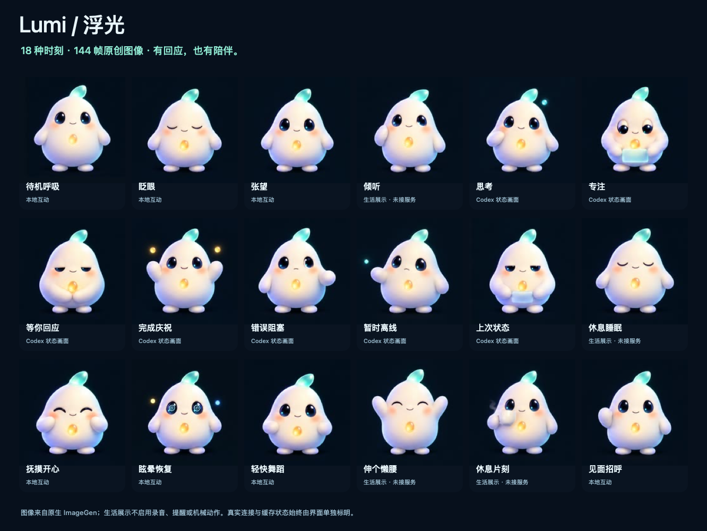

# StackChan Vibe Pet

**让 ESP32 桌宠用表情陪你工作。 / An expressive ESP32 desk companion for your workspace.**

Lumi 动画 · 触摸互动 · 本地录放音 · 实验性 BLE/HID 状态面板  
Lumi animations · touch interaction · local audio · experimental BLE/HID status display



[中文](#中文) · [English](#english) · [Safety / 安全说明](docs/SAFETY.md) · [Third-party notices](THIRD_PARTY.md)

## 中文

### 这是什么

StackChan Vibe Pet 是面向 **官方 StackChan / M5Stack CoreS3（ESP32-S3、16 MiB Flash）** 的实验性桌宠固件。它把 Lumi 表情、背部触摸互动、亲密度和主机状态汇集到一张小脸上，也保留 CLASSIC65 表情资源与皮肤切换。

本次公开源码基线为 **`0.1.11-power1`**。这是供开发者研究、构建和继续验证的源码发布，不是已经完成所有硬件验收的即刷即用产品。BLE/HID 方案继承自社区 VibeStackChan，不是 OpenAI 官方集成；不保证与任何当前版本的 Codex 应用兼容。

### 功能与边界

- **Lumi 表情：** 18 种状态、144 帧资源，配合待机、触摸与主机状态展示；LOOKS 页面可预览表情并切换 Lumi / CLASSIC 皮肤。
- **本地互动：** 背部触摸、亲密度持久化、IMU 状态与运动保护。表情预览不触发对应机械动作。
- **实验性主机联动：** BLE HID 协议支持最多六个主机状态槽，以及选中、确认、拒绝等本地触屏操作。连接成功不代表主机状态协议可用。
- **本地音频：** 手动触发 150 ms 提示音、5 秒录音和单次回放。录音只保存在设备易失性内存中，不写入文件、不上传、不自动播放。
- **受保护的运动代码：** 包括点头、张望和舞蹈逻辑；运动默认关闭，必须在设备上明确操作才能尝试开启。**当前版本的实体运动恢复尚未验收。**
- 本构建没有 Wi-Fi 服务、云端语音、摄像头功能或远程运动授权；`MAC MIC` 是主机 HID 控制，与设备的本地录音不同。

### 构建与测试

需要 Python **3.11+**、Git、Make、Clang / Clang++ 和联网下载构建依赖的环境。在取得本仓库源码后，从仓库根目录执行：

```sh
python3 -m venv .venv
.venv/bin/python -m pip install -r requirements-build.txt
sh scripts/build.sh
sh tests/run_host_tests.sh
.venv/bin/python -m unittest discover -v -s tests -p 'test_*.py'
```

构建会获取固定版本的依赖，应用带哈希校验保护的 BSP、音频和 HWCDC 补丁，再编译固件与原生 LittleFS 工具，并校验文件系统打包及读回。构建产物为 `dist/` 中的分段镜像。依赖哈希不匹配时应先检查上游变化，不要跳过保护。

**这些命令不会授权刷写，也不证明实体功能通过测试。** 本仓库不提供通用刷写命令。刷写前必须核对实际板型、Flash 容量、分区表与镜像地址，制作并验证自己的私有备份，准备适合自己设备的恢复方法。请先阅读 [安全说明](docs/SAFETY.md)，不要直接使用 `pio upload` 或将其他设备的整片备份写入本机。

### 屏幕操作

| 页面 / 控件 | 作用与注意事项 |
| --- | --- |
| PET | 桌宠主页，显示表情、LOVE 与主机状态。`UNKNOWN` / `LAST STATE` 不代表实时主机状态。 |
| CODEX → LOOKS | 浏览 Lumi 表情，切换 Lumi / CLASSIC。预览标记为 `PREVIEW / NO ACTION`。 |
| CODEX → PAIR | 主动开始 BLE 配对流程。只与自己信任的主机配对；配对与主机软件兼容性仍需自行验证。 |
| HOLD OK / HOLD NO | 在允许操作的主机状态下，长按后松开，发送确认或拒绝。**先在主机上阅读完整请求。** |
| SEND / FAST / FORK / MAC MIC | 发送对应的实验性主机 HID 控制。行为取决于主机软件，不是本地语音助手。 |
| CODEX → AUDIO | 本地音频页。长按 `HOLD REC` 约 1 秒后松开，等待 `SPEAK NOW` 再说话；录制 5 秒。 |
| PLAY ONCE / STOP / CLEAR | 手动回放一次；停止并清空录音。离开音频页或关闭屏幕也会取消并清空本地录音。 |
| HOLD MOVE / HOLD DANCE | 实体运动实验入口，不是已验收功能。请先读安全说明，不要把长按开启当作普通上手步骤。 |
| STOP | 请求关闭运动、停止并清空本地音频。不能代替物理断电，也不是主机任务的通用撤销键。 |

### 当前验证状态

截至 **2026-11-05**，`0.1.11-power1` 已在一台目标设备完成一次部署及镜像摘要校验、短时间静音运行、运动供电关闭状态的 GPIO 配置读回，以及已有数据保留检查。

以下内容**未在该版本完成端到端验收**：上电后的实际电机供电与姿态反馈、HOLD MOVE 和机械动作恢复、真实录放音、BLE 旧绑定重连、Codex 实际联动、实体屏幕观感及长期稳定性。启动仍有 I2S 未安装提示，USB 时序波动也未完全消除。关闭状态的寄存器正确，不能推出开启后一定安全或可用。

本次开源导出的构建、28 个 host 测试入口与 29 项 Python 单元测试已在本地通过，见 [验证记录](docs/VALIDATION.md)。

主机单元测试和驱动模型有助于验证逻辑，不能替代设备上的电气、机械、音频和互联测试。开源导出有意排除设备备份、配对信息、MAC 地址、私人日志、原始私有参考材料、设备专用刷写脚本及预编译镜像。

### 参与和许可

欢迎提交可复现的问题与小范围改进。报告问题时请附固件版本、板型、构建环境、复现步骤及脱敏后的错误信息；不要上传 Flash / NVS 备份、蓝牙身份、账号信息或私人会话内容。涉及运动、电源、HID 授权和录音的改动，请说明风险并增加测试。

本项目原创贡献采用 [MIT License](LICENSE)。上游代码、库和资源保留各自许可与声明，见 [THIRD_PARTY.md](THIRD_PARTY.md) 和 `licenses/`。MIT 声明不替代上游材料的许可条件。

## English

### What it is

StackChan Vibe Pet is experimental desk-companion firmware for the **official StackChan / M5Stack CoreS3 hardware, with an ESP32-S3 and 16 MiB of flash**. It brings Lumi expressions, rear-touch interaction, affection tracking and host status to a small animated face. It also includes the CLASSIC65 face assets and a skin selector.

This source release is based on **`0.1.11-power1`**. It is intended for developers to inspect, build and validate, rather than a fully hardware-qualified, ready-to-flash product. Its BLE/HID integration is inherited from the community VibeStackChan project. It is not an official OpenAI integration, and compatibility with any current Codex application is not guaranteed.

### Features and scope

- **Lumi animation:** 18 states and 144 frames for idle, touch and host-status presentation. The LOOKS gallery previews expressions and switches between Lumi and CLASSIC skins.
- **Local interaction:** rear-touch input, persistent affection tracking, IMU monitoring and motion guards. Previewing an expression does not perform the matching physical action.
- **Experimental host controls:** BLE HID support for up to six host-status slots, selection and deliberate touchscreen actions such as approval and rejection. A Bluetooth connection alone does not establish host-protocol compatibility.
- **Local audio:** manually triggered 150 ms tone, five-second recording and one-shot playback. Audio stays in volatile device memory, with no file storage, upload or automatic playback.
- **Guarded motion code:** nodding, looking and dancing logic, with motion off by default and explicit on-device activation. **Physical motion recovery has not passed acceptance testing on this version.**
- This build provides no Wi-Fi service, cloud voice assistant, camera feature or remote motion authorization. `MAC MIC` is a host HID control, separate from the device's local recorder.

### Build and test

Prerequisites: Python **3.11+**, Git, Make, Clang / Clang++, and network access to fetch build dependencies. From the root of your source checkout:

```sh
python3 -m venv .venv
.venv/bin/python -m pip install -r requirements-build.txt
sh scripts/build.sh
sh tests/run_host_tests.sh
.venv/bin/python -m unittest discover -v -s tests -p 'test_*.py'
```

The build fetches pinned dependencies, applies hash-guarded BSP, audio and HWCDC patches, compiles the firmware and native LittleFS tooling, and checks the filesystem packaging round trip. Split images are generated in `dist/`. Investigate a dependency hash mismatch instead of bypassing the guard.

**These commands are not flashing instructions or proof of hardware acceptance.** There is no universal flash command in this repository. Before flashing, verify your exact board, flash capacity, partition layout and image offsets; make and verify your own private backup and recovery plan. Read [SAFETY.md](docs/SAFETY.md) first. Do not simply run `pio upload` or restore another device's full-flash backup.

### On-device controls

| Page / control | Behavior and precautions |
| --- | --- |
| PET | Face, LOVE and host-status display. `UNKNOWN` and `LAST STATE` do not mean live host status. |
| CODEX → LOOKS | Browse Lumi expressions and select Lumi / CLASSIC. Gallery previews are labeled `PREVIEW / NO ACTION`. |
| CODEX → PAIR | Deliberately start BLE pairing. Pair only with a trusted host; pairing and software compatibility still require verification. |
| HOLD OK / HOLD NO | Hold and release to approve or reject when the host state permits it. **Read the full request on the host first.** |
| SEND / FAST / FORK / MAC MIC | Experimental host HID controls. Their behavior depends on host software; these are not a local voice assistant. |
| CODEX → AUDIO | Hold `HOLD REC` for about one second, release, then wait for `SPEAK NOW`. Capture lasts five seconds. |
| PLAY ONCE / STOP / CLEAR | Play the recording once, or stop and clear it. Leaving the audio page or turning the screen off also cancels and clears local audio. |
| HOLD MOVE / HOLD DANCE | Experimental physical-motion controls, not accepted features. Read the safety guide before considering a motion test. |
| STOP | Requests motion shutdown and stops/clears local audio. It cannot replace physical power-off and is not a general undo button for host tasks. |

### Validation status and limitations

As of **2026-11-05**, `0.1.11-power1` completed one deployment with image-digest verification on one target device, short silent-runtime observations, GPIO readback of the motion power-off configuration, and checks that existing stored data was retained.

The following have **not passed end-to-end acceptance on this version**: powered motor behavior and pose feedback, HOLD MOVE and physical motion recovery, actual audio recording/playback, reconnecting an existing BLE bond, real Codex integration, visual inspection of the physical display, and long-term stability. Startup still emits I2S-not-installed messages, and USB timing variation remains. Correct power-off register values do not establish safe or functional power-on behavior.

The public export passed the local build, 28 host-test entry points and 29 Python unit tests. See the [validation record](docs/VALIDATION.md).

Host tests and driver models help validate logic; they cannot replace electrical, mechanical, audio or interoperability tests on real hardware. This public export intentionally excludes device backups, pairing data, MAC addresses, private logs, original private reference material, device-bound flashing scripts and precompiled binaries.

### Contributing and licensing

Reproducible issues and focused improvements are welcome. Include the firmware version, board, build environment, reproduction steps and sanitized errors. Do not upload flash/NVS backups, Bluetooth identities, account details or private conversation content. Changes involving motion, power, HID authorization or recording should explain their risks and add tests.

Original contributions are licensed under the [MIT License](LICENSE). Upstream code, dependencies and assets retain their own licenses and notices. See [THIRD_PARTY.md](THIRD_PARTY.md) and `licenses/`; the MIT license does not replace upstream terms.
